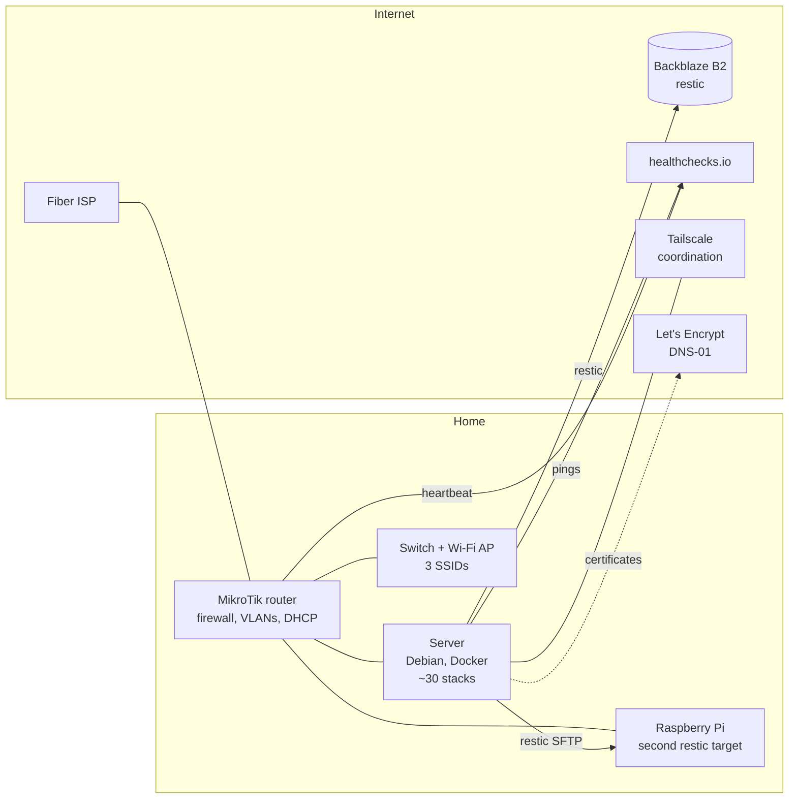
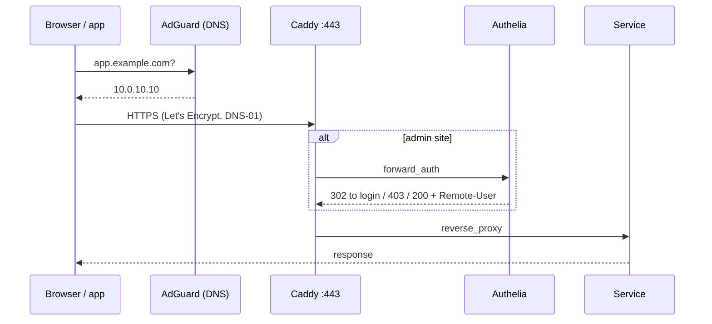
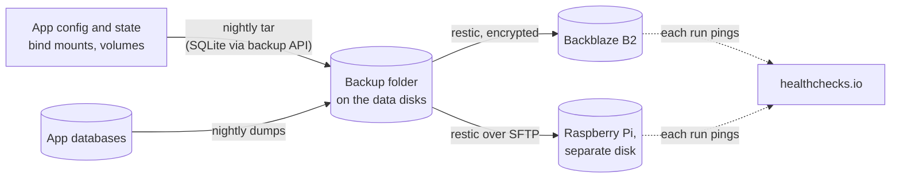
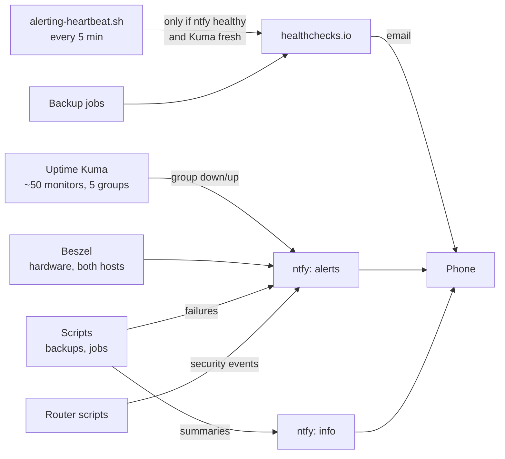

# Homelab platform

How I run about 30 self-hosted services on one bare-metal server at home, run like a small production
platform: everything as code in git, pinned and reviewed updates, one TLS entry point with SSO, a segmented network
without port forwards, 3-2-1 backups that report on themselves, and monitoring whose own alert path is monitored.

This repo holds the design and a cleaned-up selection of the scripts. Addresses and names are examples; the live
configuration (compose files, proxy and identity config, network policy) stays private.

| Folder | What |
|---|---|
| `docker/update-stacks.sh` | Applies reviewed image updates per stack |
| `.github/` | Renovate config and workflow: a PR per new image version, never auto-merged |
| `backup/` | restic offsite backup with safety checks, readable summaries, and a nightly digest |
| `monitoring/alerting-heartbeat.sh` | Dead-man's switch for the alerting path itself |

## Architecture

### Server

- Intel Core i5-13500 (iGPU passed into containers for hardware video transcoding, load-tested at 4 parallel
  1080p streams at 6.8× real time), 32 GB RAM, NVMe system disk, separate data disks.
- Debian 13, Docker with Compose, ~30 stacks / ~55 containers, each stack in its own folder.
- Local LLMs with Ollama and Open WebUI next to cloud models through OpenRouter.
- Power-tuned: the whole network cupboard (server, router, switch) averages about 45 W.

### Network

Five VLANs, routed and filtered by the router. Nothing is port-forwarded and there is no UPnP; the WAN drops all
inbound traffic.

| VLAN | Members | Can reach |
|---|---|---|
| servers | the server, the backup Pi | other servers, IoT (home automation → devices), internet |
| trusted | laptops, phones | everything |
| iot | lights, speakers, TV, smart meter reader | only DNS and a few named ports on the server; internet |
| guest | guest Wi-Fi | internet only |
| mgmt | router, switch, AP | controller ports only |

- **Split-horizon DNS**: internal hostnames resolve only through the local resolver (AdGuard Home on the LAN and
  over Tailscale split DNS), with the router as an ad-blocking fallback. There are no public DNS records for
  internal services; certificates come from Let's Encrypt through the DNS-01 challenge.
- **Discovery across VLANs** (home automation ↔ speakers, lights) through the router's mDNS repeater instead of
  flattening the network.
- **Remote access only through Tailscale**: the server is a subnet router. Access control lists per group: admins
  reach everything; other household members reach only HTTPS on the reverse proxy and DNS, so anything they use
  must be a proper HTTPS site, never a raw port.

### How a request travels

- **One entry point**: Caddy terminates TLS for every site.
- **SSO**: Authelia in front of every admin interface (default deny, admins only), and as OIDC provider
  for apps that support it. Apps used by the household keep their own login, because mobile, WebDAV and sync
  clients can't follow a login redirect.
- **Least privilege for containers**: dashboards and monitoring never get the Docker socket; they use a read-only
  Docker API proxy.

### Configuration as code

- The git repository **is** the live configuration: stacks run from it, crontabs are versioned in it and installed
  from it. Secrets stay in `.env` files that git refuses (`info/exclude`), with an `.env.example` committed.
- **Every image is pinned** to a specific version. Renovate opens one PR per new version (weekly, security fixes
  at any time), labels stacks with breaking upgrades as `manual`, never proposes database majors and never merges
  on its own. After merging, `update-stacks.sh` applies the safe stacks; the rest by hand after reading the notes.
- Session write-ups and runbooks live next to the config, so every change has its reason written down.

### Backups (3-2-1)

- Config and state are archived every night; databases are dumped, never copied live (a live SQLite copy once
  broke both restic runs). The archives are owner-only, because they contain keys and `.env` files.
- restic encrypts and deduplicates to two targets, Backblaze B2 offsite and a Raspberry Pi with its own disk, with
  retention (4 hourly, 3 daily, 1 weekly, 1 monthly, 3 yearly) and a `restic check` after every run.
- `backup/restic-offsite-backup.sh` refuses to run on an empty or wrong volume (mount, canary file, file count),
  stops a hung run cleanly with a timeout, and reports the step that failed.
- Media that can be recreated is excluded on purpose; personal data and synced folders are included.

### Monitoring and alerting

- **Two topics only**: `alerts` (act on it) and `info` (summaries, low priority). Nightly backups send one
  digest instead of one message each.
- **Alerts per group, not per monitor**: a host-wide hiccup sends at most 5 notifications instead of ~50.
- **The alert path is monitored from outside**: healthchecks.io only gets its heartbeat while ntfy is healthy and
  Uptime Kuma checked something in the last 5 minutes, and emails when it stops. That keeps working when the
  server, the router or the internet connection is down.
- A "needs attention" list on the dashboard aggregates everything that is wrong right now, and disappears when
  nothing is.

## Design decisions

| Decision | Why |
|---|---|
| No port forwards; Tailscale for remote access | Nothing for bots to hit, and the same URLs everywhere |
| Split DNS instead of hairpin NAT | The ISP router's NAT loopback broke TLS from inside |
| One reverse proxy with DNS-01 certificates | Real certificates for internal-only names, no public records |
| SSO for admin sites, own logins for household apps | Mobile, WebDAV and CalDAV clients can't follow a login redirect |
| Every image pinned, Renovate PRs, no auto-merge | An unattended major update once broke logins across two apps |
| Config backups as archives first, then restic | One encrypted offsite pipeline for everything |
| Never copy a live SQLite file | Torn copies, and archive errors that broke the offsite runs |
| Two notification topics plus email from outside | Phone-first, no alert storms, and a path that works when the server is down |
| One AI provider gateway, one API key with a cap per app | Exact cost per call, and one runaway job can't stop another app |

## License

MIT
